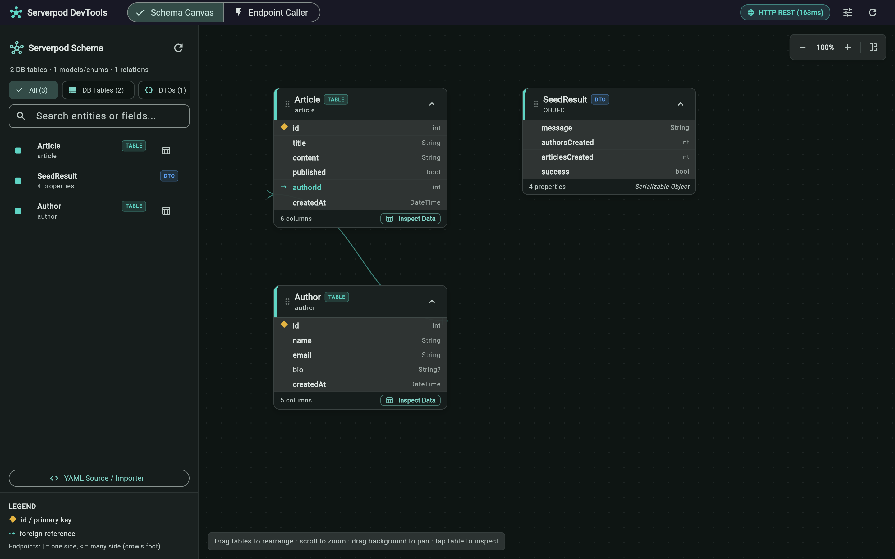
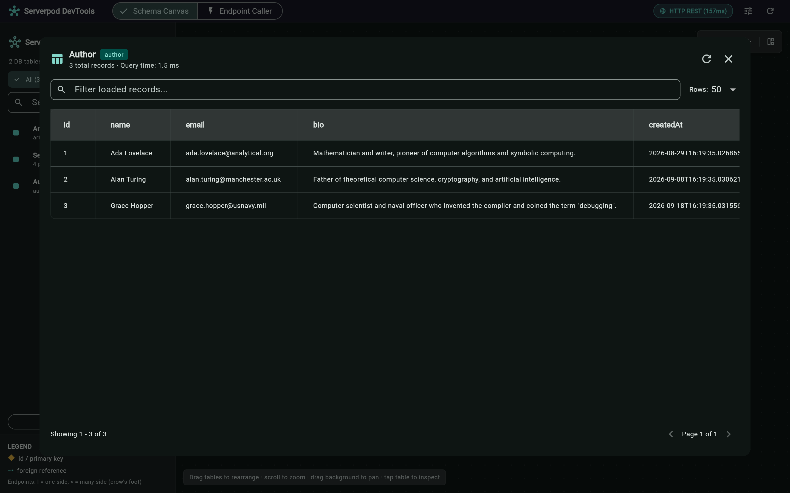
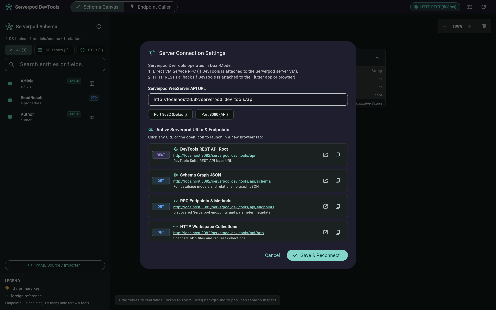
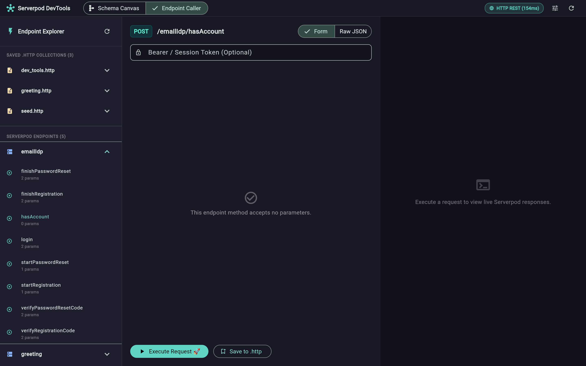
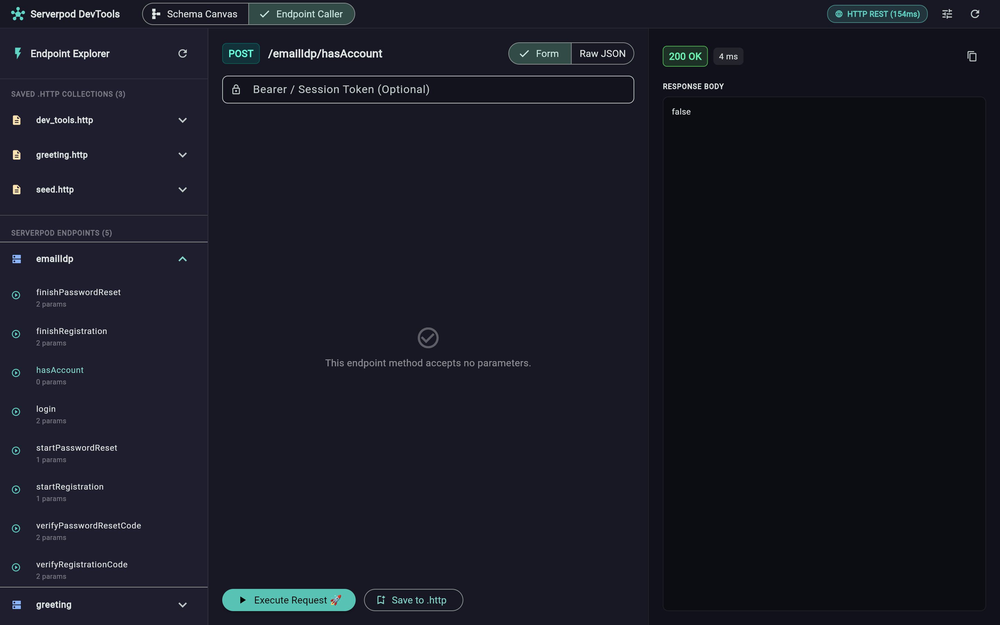
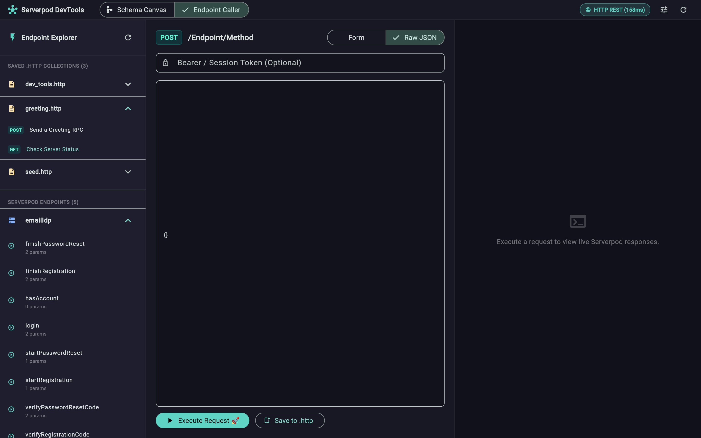
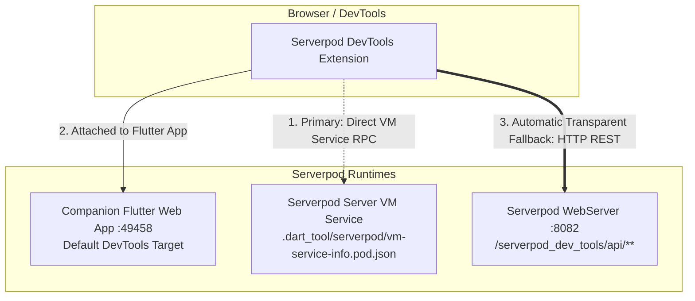

# Serverpod DevTools (`serverpod_dev_tools`)

[](https://flutter.dev/blog/dart-flutter-devtools-extensions)
[](https://serverpod.dev)
[]()

A comprehensive, developer-first **Dart DevTools Extension** and full-stack development suite built specifically for **any** [Serverpod](https://serverpod.dev) application.

`serverpod_dev_tools` provides an all-in-one developer workspace directly inside Dart DevTools, combining interactive database schema visualization, real-time database inspection, an interactive endpoint explorer and RPC caller, bi-directional `.http` workspace file synchronization, an intelligent dependency-ordered mock data seeder, and **Dual-Mode Connectivity** (VM Service RPC + HTTP REST fallback).

---

## ⚡ Key Highlights

* **Dual-Mode Resilient Connectivity**: Seamlessly switches between direct Dart VM Service RPC and HTTP REST fallback so DevTools works whether attached to the backend server VM, a companion Flutter app (e.g. `studio_flutter`), or opened standalone in a browser.
* **Schema Mapper & ER Visualizer**: Draggable 2D canvas with authentic Crow's foot notation (`|` for one, `<` for many), foreign key inference, cluster highlighting, and raw `.spy.yaml` viewer.
* **Live PostgreSQL DataGrid**: Secure, paginated live database browser with sortable columns, type-aware cell formatting, and row search.
* **Endpoint Explorer & RPC Caller**: Postman/Swagger-style playground for Serverpod endpoints with typed argument forms, live execution metrics, and auth token support.
* **RFC 7230 `.http` Workspace Suite**: Full bi-directional sync with workspace `.http` files (e.g. `course.http`, `homework.http`), variable interpolation (`{{baseUrl}}`), and 1-click execution.
* **Dependency-Ordered Mock Seeder**: Kahn's DAG topological sorter that seeds parent tables before dependent foreign-key children, with realistic data generation (RFC 4122 UUIDs, emails, timestamps).
---

## 📸 Screenshots & Feature Walkthrough

### 1. Interactive ER Database Schema Canvas
A high-performance 2D interactive canvas that parses your Serverpod `.spy.yaml` models in real time, rendering tables, field types, primary keys, and authentic Crow's foot relationship edges (`|` for one, `<` for many). Features interactive panning, zooming, filtering chips, and quick-action shortcuts.



---

### 2. Live PostgreSQL Database Table Inspector
Click **"Inspect Data"** on any table node to open a live, real-time database viewer directly connected to PostgreSQL. Browse records, search and filter across columns, inspect data types, view row counts, and paginate through large datasets with sub-millisecond query feedback.



---

### 3. Dual-Mode Server Connection Settings
Easily configure and monitor connectivity between Dart DevTools and your Serverpod backend. Seamlessly toggle between direct Dart VM Service JSON-RPC and the Serverpod WebServer HTTP REST API fallback (Port 8082 vs Port 8080), complete with real-time health checks and latency diagnostics.



---

### 4. Serverpod Endpoint Explorer & Method Caller
A built-in API testing playground tailored for Serverpod. It automatically discovers all registered endpoints and methods, rendering type-safe form inputs for complex and primitive parameters, along with optional authentication token headers.



---

### 5. Live Request Execution & Real-Time Response Console
Execute Serverpod RPC calls and HTTP requests with a single click. Inspect formatted syntax-highlighted JSON responses, HTTP status badges, latency timers, and round-trip diagnostics in real time.



---

### 6. Integrated Workspace `.http` File Suite
Store and manage your API calls in standard RFC 7230 `.http` files right inside your repository. Browse collections organized by domain, test requests with dynamic variable replacement (`{{baseUrl}}`), and execute requests directly from the sidebar.



---

## 🏗️ Architecture & Connectivity Modes

When developing with Serverpod, projects frequently run both the backend server (`studio_server`) and companion Flutter apps (`studio_flutter`). `serverpod_dev_tools` handles both environments transparently:



### 1. Direct VM Service RPC Mode 🟢
* **When active**: When Dart DevTools is directly connected to the Serverpod server's Dart VM service.
* **Protocol**: Dart VM Service JSON-RPC extensions (`ext.serverpod_dev_tools.*`).
* **Latency**: < 10ms in-memory RPC.

### 2. HTTP REST Fallback Mode 🔵
* **When active**: When DevTools is attached to a companion Flutter web/mobile app (which lacks Serverpod VM service extensions) or opened standalone in a browser.
* **Protocol**: HTTP REST API served on Serverpod's WebServer (`http://localhost:8082/serverpod_dev_tools/api/**`) with CORS enabled (`access-control-allow-origin: *`).
* **Latency**: 10–30ms local HTTP roundtrip.

---

## 🚀 Getting Started

### 1. Add Dependency

Add `serverpod_dev_tools` to your Serverpod server's `pubspec.yaml`:

```yaml
dependencies:
  serverpod: ^4.0.2
  serverpod_dev_tools:
    path: path/to/packages/serverpod_dev_tools
```

### 2. Initialize in `server.dart`

In your Serverpod server entrypoint (`lib/server.dart`), call `ServerpodDevTools.initialize(pod)` before starting the server:

```dart
import 'package:serverpod/serverpod.dart';
import 'package:serverpod_dev_tools/serverpod_dev_tools.dart';

void run(List<String> args) async {
  final pod = Serverpod(
    args,
    Protocol(),
    Endpoints(),
  );

  // Initialize Serverpod DevTools (registers VM service RPC extensions & HTTP REST routes)
  ServerpodDevTools.initialize(pod);

  await pod.start();
}
```

#### Custom Initialization Options

```dart
ServerpodDevTools.initialize(
  pod,
  modelsDirectory: Directory('lib/src/models'), // Custom .spy.yaml location
  httpDirectory: Directory('http'),              // Custom .http files location
  enableWebRoute: true,                          // Mounts HTTP REST API on pod.webServer
  webRoutePath: '/serverpod_dev_tools',          // Base path for HTTP REST API
);
```

### 3. Open in Dart DevTools

1. Start your Serverpod server:
   ```bash
   serverpod start
   # or: dart run bin/main.dart
   ```
2. Open Dart DevTools in VS Code (via Command Palette: `Dart: Open DevTools`) or in Chrome.
3. Select the **Serverpod DevTools** tab.
4. The extension automatically detects your Serverpod instance and displays the connection badge:
   - 🟢 **VM Service**: Connected directly to the server VM.
   - 🔵 **HTTP REST (:8082)**: Connected via Serverpod WebServer REST API.

---

## 🌐 WebServer REST API Reference

When `enableWebRoute` is enabled (default `true`), the following endpoints are available on Serverpod's WebServer (`http://localhost:8082/serverpod_dev_tools/api`):

| Endpoint | Method | Description |
|---|---|---|
| `/schema` | `GET` | Returns full [SchemaGraph] JSON (tables, fields, relations, indexes). Query param `forceRefresh=true` forces re-scanning disk. |
| `/data` | `GET` | Returns paginated [TableDataPage] JSON for a table. Params: `table`, `limit`, `offset`, `sortBy`, `sortAscending`, `search`. |
| `/stats` | `GET` | Returns row counts (`Map<String, int>`) for all database tables. |
| `/endpoints` | `GET` | Returns all registered Serverpod endpoints and callable RPC methods. |
| `/http` or `/http-collections` | `GET` | Returns parsed `.http` file collections with requests and variables. |
| `/invoke` | `POST` | Invokes an endpoint method with payload `{"endpoint": "...", "method": "...", "parameters": {...}, "authToken": "..."}`. |
| `/save_http` | `POST` | Saves/appends an HTTP request to disk: `{"fileName": "custom.http", "request": {...}}`. |
| `/mock` | `POST` | Generates mock rows: `{"rowsPerTable": 3, "seedLiveDb": false}`. Returns rows, SQL script, and Dart script. |
| `/order` or `/dependency_order` | `GET` | Returns foreign-key topological order for table seeding. |

All endpoints include CORS headers:
```
access-control-allow-origin: *
access-control-allow-methods: GET, POST, OPTIONS
access-control-allow-headers: content-type, authorization
```

---

## 🛠️ Troubleshooting & FAQs

### Q: Why did DevTools say `Unknown method "ext.serverpod_dev_tools.getSchema" (-32601)`?
**Cause**: When launching full-stack apps via `serverpod start`, Dart DevTools often connects by default to the **Flutter companion app** (`studio_flutter`), which does not have Serverpod server extensions registered.

**Solution**:
1. With `serverpod_dev_tools` v0.1.0+, the extension **automatically falls back to HTTP REST** (`http://localhost:8082/serverpod_dev_tools/api`), so you don't have to change anything!
2. If your Serverpod WebServer is on a non-default port (e.g. `8080`), click the **Gear Icon** in the top bar to change the URL.
3. If you want direct VM Service RPC connection, copy your server's VM Service URI from:
   `apps/studio/studio_server/.dart_tool/serverpod/vm-service-info.pod.json`
   and paste it into DevTools' "Connect" prompt.

### Q: Where are `.http` files saved?
By default, `.http` files are read from and written to `studio_server/http/` (or `http/` at the server root). You can organize requests by domain (e.g. `course.http`, `student.http`, `auth.http`).

---

## 🧪 Testing & Verification

Run the automated test suite covering `.spy.yaml` parsing, relation inference, `.http` scanning, topological sorting, and mock generation:

```bash
dart test packages/serverpod_dev_tools/test
```

Run static analysis:

```bash
dart analyze packages/serverpod_dev_tools/lib packages/serverpod_dev_tools/devtools_app/lib packages/serverpod_dev_tools/test
```

Rebuild the DevTools extension web bundle:

```bash
sh tool/build_serverpod_dev_tools_extension.sh
```

---

## 📄 License

MIT
